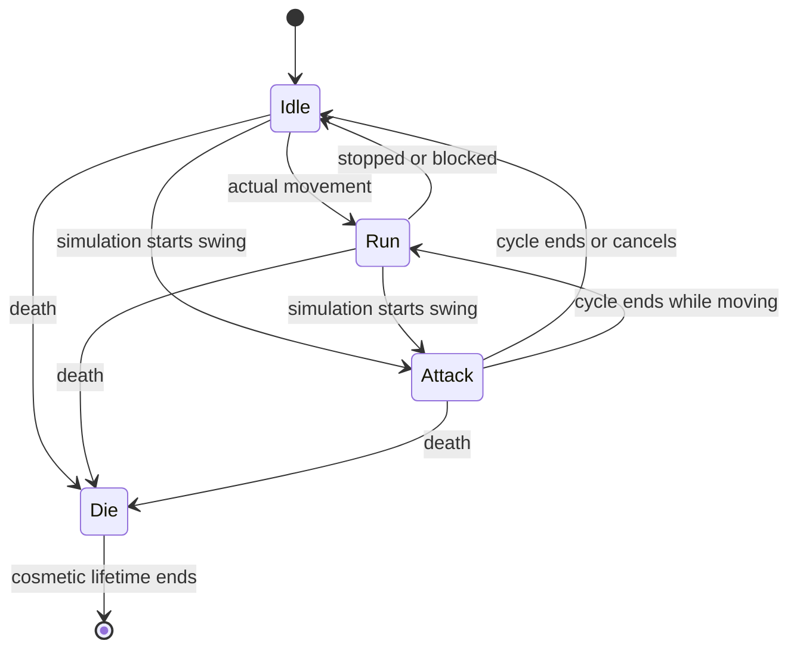

# Stage 4 — Asset integration, animation và audio

Engine: **Godot 4.5.2 Standard / typed GDScript**. Stage 4 nối combat simulation
với sprite animation, adaptive music và voice feedback. Mã thật nằm trong
`scripts/animation`, `scripts/audio`, `scripts/assets`; scene tích hợp chạy bằng F9.

## 1. Chạy thử trước khi thay asset

1. Mở `project.godot`, nhấn **F5**, rồi **F9** để vào Animation & Audio Lab.
   F9 thay scene và bỏ sandbox đang chơi; F6 trở về sandbox mới.
2. **Select Bundschuh / Select League** đổi phe đang chọn và phát một acknowledgement.
3. **Preview Run** xem chạy tại chỗ; **Rate +15%** đổi tốc độ của cả animation chạy
   và nhịp combat bằng modifier thật. Đây là bàn thử animation, không phải AI di chuyển.
4. **Attack** ra lệnh cho sáu cặp đấu bằng `CombatWorld`. Quan sát weapon contact,
   HP và tỷ lệ Combat music khi có 12 người giao tranh trong viewport.
5. **Idle** hủy lệnh; nhạc trở về Eco sau cửa sổ recent activity, quiet hold và fade.
   **Preview Die** xóa thực thể preview, giữ death visual tới khi hết thời gian.
6. Space pause/resume; hai toggle Music/Voices là mixer bus thật. Phụ đề vẫn hiển
   thị khi Voices bị mute. Reset tạo lại arena và giữ nguyên pool đã cấp phát.

```sh
godot --headless --path . --script examples/stage4_backend_demo.gd
python3 tools/verify.py --godot /path/to/godot
```

**Asset đi kèm là placeholder:** hai atlas SVG do project tạo và âm tổng hợp để
kiểm tra đường tín hiệu. Tone không phải tiếng nói Đức, nhạc lute, brass hoặc
chorale đã thu. 18 câu thoại là draft casting với cách viết hiện đại hóa theo
hướng GDD, chưa phải bản Frühneuhochdeutsch được thẩm định. Scene ghi rõ điều này.
Code có thể nhận bản thu thật bằng cách thay Resource; không cần đổi combat.

F5/F6/F7/F8 vẫn là sandbox economy/navigation. Stage 4 lab tích hợp animation,
combat và audio; chưa thay toàn bộ art sandbox, chưa thêm military navigation,
patrol AI, projectile flight hay campaign hoàn chỉnh.

## 2. Hợp đồng giữa simulation và presentation

| Lớp | Trách nhiệm |
|---|---|
| `CombatWorld` / `CombatUnit` | Attack serial, cycle work, wind-up marker, hit và cancellation |
| `UnitAnimationSet` | SpriteFrames, pivot, directions, marker; compile/cache frame data lúc loading |
| `RtsUnitAnimator` | Idle/Run/Attack/Die, hai Sprite2D blend, hiển thị phase từ simulation |
| `UnitViewPool` | Tối đa 200 view đã prewarm; trả lại/reuse, ưu tiên người sống hơn corpse |
| `CombatMusicDirector` | Tập unit vừa giao tranh, lọc viewport/visibility, hysteresis ở 4 Hz |
| `SoundManager` | Synchronized stems, crossfade, voice pool, pause, ducking và subtitles |
| `UnitFeedbackBus` | Một speaker hợp lệ cho group selection hoặc lệnh đã được chấp nhận |
| `VoiceSelector` | Index faction/action, RNG cosmetic riêng, tránh lặp hai take gần nhất |
| `RtsAudioBank` / `RtsVoiceLine` | Resource assets, captions và metadata casting |
| `PresentationAssetScope` | Background loading có trạng thái, giữ rồi giải phóng reference theo scene |

Damage không xuất phát từ callback của sprite/AnimationPlayer. Simulation quyết
định hit; renderer đọc cùng clock và nhận `hit_resolved` để giữ contact pose. Tắt
camera, bỏ view do quá ngân sách hoặc đổi FPS không được làm mất/double damage.
Model combat không biết Node, texture, mixer hoặc SceneTree.

## 3. Animation state machine



Ưu tiên **Die > Attack > Run > Idle**. Die không bị lệnh Move/Attack hoặc hit callback
cũ ngắt. Idle/Run lặp; Attack/Die không lặp tự do. Animator được một host gọi
`advance(game_delta)`; không có `_process()` riêng cho mỗi lính.

### 3.1 Chuẩn bị SpriteFrames và profile

Artist tạo một `SpriteFrames` Resource, lấy frame từ atlas bằng AtlasTexture.
Tên clip bắt buộc:

| Hướng | Tên clip |
|---|---|
| Một hướng trong placeholder | `idle_s`, `run_s`, `attack_s`, `die_s` |
| Bộ tám hướng thật | `idle_e`…`idle_ne`; tương tự `run_*`, `attack_*`, `die_*` |

Thứ tự `directions` cho tám hướng: **e, se, s, sw, w, nw, n, ne** theo mặt phẳng
Godot +Y đi xuống. Frame có thể có duration khác nhau; compiler cộng duration/fps
thành bảng thời gian. Không tự mirror trang phục/vũ khí bất đối xứng.

Trong Inspector tạo `UnitAnimationSet`:

- `frames`: SpriteFrames đã author; không duplicate toàn bộ atlas cho từng unit.
- `directions`: một suffix hoặc tám suffix trên; tất cả clip phải tồn tại.
- `impact_frame`: chỉ số frame contact, bắt đầu từ **0**. Mọi hướng phải có cùng
  normalized contact time, dù texture có thể khác.
- `reference_run_speed`: vận tốc tiles/s mà artist dùng khi author Run, mặc định 0.8.
- `pivot`: cùng điểm mặt đất trên mọi frame; placeholder `(32, 54)` trong canvas 64×64.
- `blend_seconds`: mặc định 0.10s, tối đa 0.5s. Hai Sprite2D cũ/mới crossfade pose;
  đây không phải skeletal interpolation giữa các phần cơ thể.
- `corpse_seconds`: mặc định 2s sau đoạn Die. Hết thời gian thì trả view về pool.

Gọi `profile.compile()` **một lần lúc loading**. Nếu có lỗi, không cho vào trận.
Compiler giữ bảng texture/duration dùng chung; sprite chỉ thay reference frame.
Profile/frames coi như bất biến khi đang chơi; đổi asset thì compile profile mới
ở giai đoạn loading tiếp theo.

### 3.2 Run và tốc độ thật

```text
run_phase += game_delta * actual_speed_tiles_per_second / reference_run_speed
```

Host navigation đưa vận tốc dịch chuyển thực vào `set_motion`. Unit bị kẹt có
velocity 0 nên trở về Idle, dù đã có lệnh Move. Host lấy movement budget từ
`unit.movement_speed()`/`movement_budget()`, áp dụng collision/pathing, rồi mới
đưa vận tốc thực sang presentation. Buff 15% chỉ nhanh thêm nếu quân thực sự di
chuyển được. Không đổi riêng interpolation của Stage 1 để giả lập quân khác tốc độ.

Lab có Preview Run tại chỗ để artist quan sát cadence; nó cấp vận tốc preview từ
stat hiện hành và không tuyên bố đó là navigation. Combat vẫn dùng vị trí duel
cố định. Sprite animation không đẩy body hay thay đổi collision.

### 3.3 Attack: wind-up, contact và recovery

```text
impact_fraction = duration_before_contact_frame / total_authored_attack_duration
cycle_work = base_attack_period
impact_work = cycle_work * impact_fraction
elapsed_work += fixed_delta * current_attack_rate
hit when elapsed_work >= impact_work (first eligible 20 Hz tick)
visual_phase = authored_duration * elapsed_work / cycle_work
```

`CombatWorld.set_attack_timing(id, profile.impact_fraction)` bật wind-up cho unit
mới spawn. API chỉ nhận `[0, 1)` và từ chối thay marker khi swing/recovery còn chạy.
**Mặc định bằng 0** để Stage 2/3 cũ vẫn gây damage tức thời đúng fixture trước.
Lab bật `3/8 = 0.375`: Pike có cycle 3s, contact ở 1.125 base-work seconds. Clock
20 Hz lượng tử hóa hit sang tick sau ngưỡng: nếu bắt đầu ở tick 1, hit ở tick 24.
Không cộng wind-up vào attack period lần thứ hai.

Attack speed dùng work-seconds giống Stage 2. Buff vào giữa đòn chỉ đổi tốc độ
của phần còn lại, không reset swing hay cho thêm hit. Recovery giảm đồng thời với
wind-up, bắt đầu ngay lúc swing khởi động. Stage 2 aura/payroll và Stage 3 height
vẫn áp dụng; height/range/ownership được kiểm tra tại thời điểm hit.

| Tình huống | Hành vi |
|---|---|
| Stop / retarget trước contact | Hủy damage đang chờ; recovery còn lại giữ nguyên |
| Target đi ngoài range, chết/despawn, garrison hoặc đổi thành đồng minh | Hủy pending swing; không đánh qua map |
| Attacker chết/despawn, đổi owner hoặc garrison | Xóa lệnh và pending swing |
| Đòn cùng tick gây chết lẫn nhau | Snapshot cả hai hit rồi mới áp HP: vẫn trade đồng thời |
| Renderer bị cull / không có view | Damage vẫn xảy ra trong simulation |
| Pause | Cycle work, hit và visual phase đứng lại |
| Catch-up bỏ qua frame contact | `confirm_impact(serial)` giữ một lần render contact của swing hiện tại |

Các signal bổ sung: `attack_started`, `attack_cancelled`. `attack_started` có
`attacker_id`, `target_id`, `serial`, `tick`, `impact_fraction`; hit thêm cùng
`serial`. Events được emit sau transaction. Cancellation từ command ngoài tick
được thông báo ở tick kế tiếp; cờ model đổi ngay. Không gửi command đồng bộ từ
callback khi `CombatWorld.advance()` đang chạy.

```gdscript
# Loading / spawn:
var profile := load("res://art/pike_animation_set.tres") as UnitAnimationSet
assert(profile.compile().is_empty())
var view := pool.acquire(unit.id, profile, unit)
combat.set_attack_timing(unit.id, profile.impact_fraction)

# Navigation -> presentation (after collision resolution):
combat.set_position(unit.id, actual_center_in_tiles)
view.set_motion(actual_center_in_tiles * pixels_per_tile, actual_velocity_in_tiles)

# Event adapter; never apply damage a second time here:
func on_hit(event: Dictionary) -> void:
    var view: RtsUnitAnimator = pool.active.get(event.attacker_id)
    if view != null:
        view.confirm_impact(event.serial)
```

`art/pike_animation_set.tres` ở ví dụ là đường dẫn asset production do team tạo.
Ví dụ chạy ngay dùng `Stage4DemoAssets.animation_profile()` và scene lab.

## 4. Adaptive music và SoundManager

Music ngân sách hiện tại: một `AudioStreamPlayer` chứa `AudioStreamSynchronized`
với **hai stems luôn chạy cùng nhau**. Eco và Combat bắt đầu đồng thời, không
stop/restart mỗi khi camera hoặc tình hình giao tranh đổi.

Composer xuất hai stem cùng key, tempo, duration và full-loop boundaries:

- **Eco Layer:** lute/hurdy-gurdy, texture thoáng để nghe unit response.
- **Combat Layer:** drums/brass/chorale, cùng nhịp với Eco, đủ headroom khi crossfade.
- WAV/OGG/MP3 đều được bank nhận; bật loop toàn file, không dùng intro/loop offset
  khác nhau trong bộ hai stem hiện tại. `validate()` kiểm tra duration/loop.
- Master thu gốc theo GDD (48kHz/24-bit); chọn encode runtime sau khi nghe thử.
  Source music placeholder chỉ là tín hiệu tổng hợp ở 22.05kHz/16-bit.

### 4.1 Định nghĩa “hơn 10 unit đang giao tranh trong viewport”

`CombatMusicDirector` nhận `attack_started` và `hit_resolved`, ghi ID attacker và
target vào tập recent fighters. Cùng một unit bắn 100 đòn vẫn chỉ đếm một người.
Mặc định recent window **4 game seconds**. Tại mỗi lần poll **0.25s**:

1. Loại người đã chết/despawn/garrison hoặc quá recent window.
2. Chỉ đếm unit nằm trong `viewport_tiles` và nằm trong tập IDs được phép biết.
3. **Ít nhất 11** người → Combat. Đúng 10 không kích hoạt.
4. Khi đã Combat: **tối đa 6** người trong **5s liên tục** → Eco. 7–10 giữ state;
   trận mới tới ngưỡng 11 xóa quiet hold.

Ngưỡng, recent window và quiet hold là thuộc tính director để scenario chỉnh.
Viewport phải ở **tile coordinates** cùng combat; trừ vùng HUD đặc che chiến
trường. Trong game có camera, chuyển góc vùng playfield qua canvas transform
ngược rồi chia pixel-per-tile. Đổi viewport được phản ánh ở lần poll kế tiếp.

**Camera không thay thế fog of war.** Host đưa `set_permitted_units(known_ids)`
trước combat step và cập nhật theo visibility service. Event ẩn ngay lúc xảy ra
không được ghi để phát lại khi camera mở ra. Lab công bố toàn bộ 12 unit vì không
có fog. F5 sandbox cũng chưa có fog; API không được coi là hệ vision hoàn chỉnh.

### 4.2 Crossfade, pause và buses

```text
mix moves continuously toward 0 (Eco) or 1 (Combat), over 2 game seconds
Eco gain    = cos(mix * pi/2)
Combat gain = sin(mix * pi/2)
```

Hai bình phương gain cộng bằng 1 (equal-power). Nếu đổi ý giữa fade thì đi từ
mức hiện tại, không nhảy âm lượng hoặc tạo Tween/Timer mới. Các stem vẫn giữ
headroom: hai tín hiệu tương quan có thể làm peak tăng; equal-power không thay
việc mix/master nghe thử.

`default_bus_layout.tres`: Master → Music/Voices. Manager giảm music thêm 3dB
với attack/release mềm khi VO player đang phát. Sliders/mute có thể dùng trực tiếp
AudioServer bus volume; lab có hai nút mute và phụ đề không phụ thuộc audio mute.

Một host gọi `sound.advance(game_delta, viewport_tiles)` sau combat step.
`set_game_paused()` pause playback thật lẫn clock/throttling. Khi tăng game speed,
timer/fade dùng game time; nhạc/VO giữ pitch tự nhiên, không tăng pitch thành 4×.
Dừng/quá tải voice không được tạo lịch thoại phát bù.

## 5. Voice event routing và biến thể theo phe

`UnitFeedbackBus.combat_selection(world, local_owner, action, ids)` chọn người
sống, đang deployed, thuộc đúng owner, ID nhỏ nhất; một group chỉ emit một câu.
Action là `selected`, `move`, `attack`. Với Move/Attack, host **chỉ gọi sau khi
command được chấp nhận**. Router không thực thi hoặc xác nhận command thay gameplay.

```gdscript
feedback.cue_requested.connect(sound.on_voice_request)
# Actual successful command, not merely clicking the Attack button:
if combat.command_attack(local_owner, attacker_id, target_id):
    feedback.combat_selection(combat, local_owner, &"attack", [attacker_id])
# Stage 1 adapter, after navigation accepts:
feedback.villager_selection(simulation, &"move", accepted_villager_ids)
```

Villager adapter từ chối Attack; Gather không giả làm Attack. Unit bị mutiny/thuộc
đối phương không nói acknowledgement của player cũ. Host có thể dùng cùng router
cho selection của scene gameplay khác; lab đã nối đủ ba event.

`SoundManager` kiểm tra sequence chống duplicate, cooldown chung mặc định **1s**
và VO player đang bận. Request thừa bị bỏ, không xếp hàng. `VoiceSelector` dùng
RNG riêng và không chọn lại hai take gần nhất nếu có ít nhất ba biến thể. Với
hai take tránh lặp ngay; một take vẫn dùng được. RNG không ảnh hưởng map/combat.

### 5.1 Thay bằng bản thu Frühneuhochdeutsch

Mở `data/presentation/voice_casting_bank.tres`, duplicate thành bank production,
rồi gắn hai music stems và stream cho từng `RtsVoiceLine`. Có sẵn ba biến thể cho
mỗi faction × action = 18 slot. Ví dụ ý nghĩa casting:

| Phe | Selected | Move | Attack |
|---|---|---|---|
| Bundschuh | `Wir hören.` | `Wohlan!` | `Für unser Recht!` |
| League | `Zu Diensten.` | `Wie befohlen.` | `Für den Bund!` |

Đây là câu sáng tác với chính tả hiện đại hóa, không phải chứng cứ rằng người năm
1525 đã nói nguyên văn. Writer/cố vấn ngôn ngữ cần duyệt vùng nói và pronunciation
trước khi ghi `language_approved = true`. Metadata `provenance` ghi nguồn bản thu;
`text_de`, `subtitle_vi` là caption. Campaign dùng lực lượng khác cần bank riêng,
không tự dùng câu League cho mọi quân trong Đế quốc.

VO ngắn ưu tiên mono WAV đã decode/import phù hợp ngân sách. Thiếu stream thì
manager emit subtitle-only và không tìm file/load từ callback. Bank casting cố
ý để `stream` trống. `Stage4DemoAssets` tạo **tone khác nhau** và gắn vào slot chỉ
để thử playback; không dùng tone làm bản thu ngôn ngữ hoặc ký duyệt lịch sử.

Signals: `subtitle_requested` và `voice_started`, payload có `line_id`, faction,
speaker, action, sequence, German text, subtitle và cờ `audio_available`/
`diagnostic_audio`. Mute voice vẫn cho caption; pause từ chối gameplay request mới.
Không dùng callback `AudioStreamPlayer.finished` làm một sự kiện gameplay.

## 6. Asset memory, warm-up và pooling

### 6.1 Loading screen

1. Manifest/scene chọn các unit profiles và audio bank cần trong màn.
2. Dùng `PresentationAssetScope.request("res://…bank.tres")`, poll mỗi frame
   loading; chỉ `load_threaded_get()` sau trạng thái LOADED. Không block combat.
3. Compile profile và validate bank một lần. Tạo/prewarm `UnitViewPool` trước khi
   cho người chơi điều khiển; `SoundManager.prepare()` tạo music mix và VO players.
4. Hiển thị atlas trong bước warm-up thực tế để driver upload texture; nghe thử
   một cue trước nghiệm thu build. Background load không bảo đảm GPU upload hoặc
   decoder cold-start hoàn toàn miễn hitch.
5. Bắt đầu simulation khi Resources và pool sẵn sàng. Không gọi load(), tạo atlas,
   tạo waveform hoặc instantiate view trong callback hit/selection.

Scope giữ Resource theo màn. Engine cache reuse chia sẻ asset; khi rời màn, dừng
player, clear stream reference, trả view về pool rồi release scope. Nếu một nơi
khác còn reference thì resource vẫn được giữ; `release()` không phải ép engine
xóa mọi bản copy. Threaded request đang chạy chưa có cancel API trong wrapper;
phải drain/poll xong rồi release.

### 6.2 Ngân sách và hành vi khi đầy

| Thành phần | Cấp phát lúc warm-up | Khi đang chơi |
|---|---|---|
| Unit visuals | 200 view / 400 Sprite2D; share compiled frame tables | Reuse view, đổi texture reference; no per-unit process/timer |
| Corpses | Dùng pool view hiện tại | Hết Die+hold thì release; thiếu chỗ thì corpse nhường cho unit sống mới |
| Music | Một player + hai synchronized streams | Chỉ đổi gain, không restart khi crossfade |
| VO | Mặc định hai player cố định, tối đa cấu hình 8 | Policy hiện tại một acknowledgement tại một thời điểm; bỏ request khi bận |
| Audio assets | Một bank/màn | Không load hoặc phát 200 câu cho selection lớn |
| Music detection | Tập recent ID, tối đa roster | Membership/viewport poll 4Hz, không overlap sphere mỗi frame |

Nếu toàn bộ 200 view đều dành cho unit sống thì `acquire()` trả null, tăng `misses`;
host phải ghi telemetry/hoãn request, không lén tạo thêm Node trong trận. Đây là
ngân sách presentation; không đổi population hoặc phép spawn gameplay. Reuse
xóa model reference, texture, selection, phase, death latch và impact serial để
entity cũ không tác động entity mới.

Hai atlas placeholder 512×256 RGBA tương đương khoảng **1 MiB tổng pixel** trước
mipmap/driver overhead. Hai diagnostic PCM music loop 8s/22.05kHz/mono/16-bit dùng
705,600 bytes; 18 tone 0.22s dùng khoảng 174,636 bytes. Đây không phải tổng memory
của process. Native AudioStream playback có chi phí khởi tạo riêng; pooling Node
không phải cam kết không có bất kỳ allocation nào trong engine.

`shutdown_and_drain()` dành cho quit có kiểm soát: nhường một engine frame, stop,
clear resource rồi cho AudioServer thời gian xử lý mix. Lab dùng luồng này khi
đóng cửa sổ. Headless demo cũng chạy engine frames thật quanh playback, không
chỉ tăng simulation clock bằng vòng for. Kill process/Stop debugger cưỡng bức có
thể vẫn sinh cảnh báo audio của engine; đó không thay kiểm tra lifecycle bình thường.

## 7. Integration checklist và phạm vi hiện tại

- Chạy verifier, kiểm tra swing/impact bằng slow-motion trên máy target; pause và
  đổi speed giữa wind-up không được tạo hit sớm hoặc thêm hit.
- Chỉ `CombatWorld` áp damage. Animator/impact SFX listeners không gọi damage.
- Đưa actual body center/velocity từ navigation. Stage 1 friendly crowd vẫn chưa
  xử lý quân hai phe khác kích thước/tốc độ; lab không thay thế phần đó.
- Dùng viewport và player visibility cùng hệ tọa độ; không để audio tiết lộ fog.
- Trước mỗi match mới, bind world mới, reset feedback sequence, clear views;
  không để event từ world cũ lọt vào ID trùng của world mới.
- Test codec/driver, headphone, mute, caption, alt-tab và thiết bị âm thanh thật.
  Headless không đánh giá tiếng nghe, click/pop, phase tương quan hoặc GPU hitch.
- Profile 200 views với asset final trên phần cứng target. Không suy FPS đồ họa
  từ số ms của model/headless; atlas 8 hướng cuối sẽ lớn hơn placeholder.

GDD Phase 4 là hướng art/audio sản xuất. Stage 4 hiện chọn hai music states và
ngưỡng **>10 unit trong viewport**, theo prompt mới; chưa triển khai toàn bộ
Peace/Tension/Battle/Crisis/Aftermath, quantize đầu ô nhịp, campaign announcer,
8-direction final art, owner-color mask hay bản thu lịch sử. Stage 2/3 overrides
về aura/payroll/high-ground vẫn có hiệu lực; GDD cũ không được tự khôi phục luật.

API engine tham khảo:
[SpriteFrames](https://docs.godotengine.org/en/4.5/classes/class_spriteframes.html),
[AudioStreamSynchronized](https://docs.godotengine.org/en/4.5/classes/class_audiostreamsynchronized.html),
[AudioStreamPlayer](https://docs.godotengine.org/en/4.5/classes/class_audiostreamplayer.html),
[ResourceLoader](https://docs.godotengine.org/en/4.5/classes/class_resourceloader.html).
